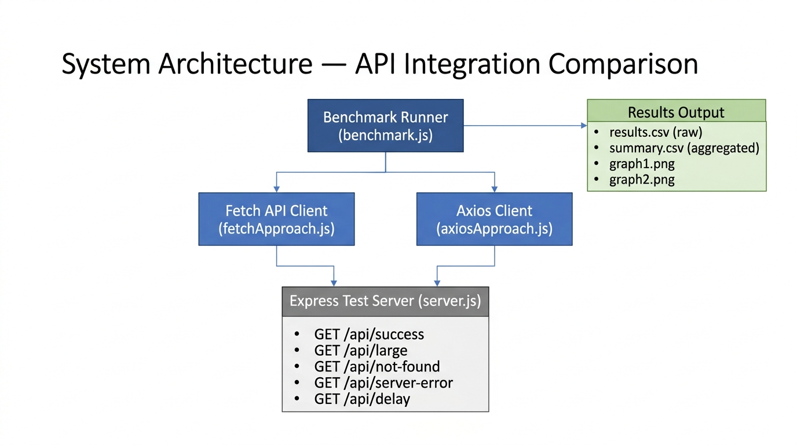
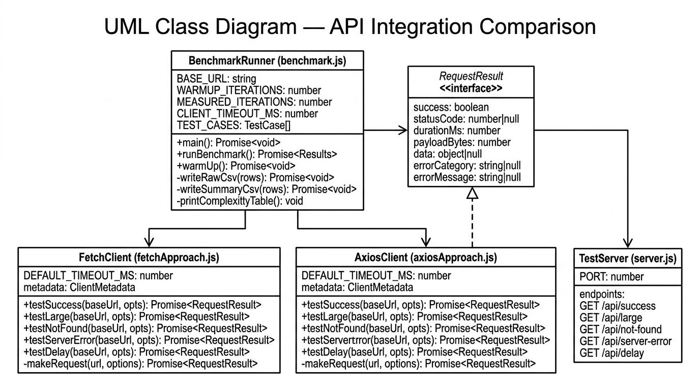
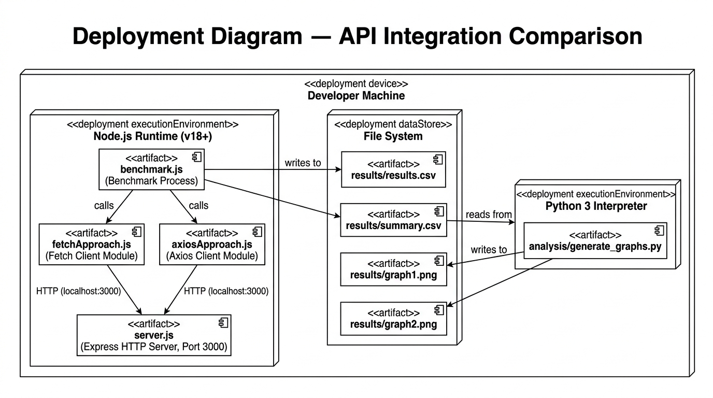

# API Integration Comparison

> **Academic case study:** Native Fetch API (Approach A) vs Axios (Approach B) in Node.js.

This project implements a controlled benchmark to compare two approaches to HTTP client integration across five dimensions: response time, error handling, integration complexity, dependency footprint, and implementation effort.

---

## Table of Contents

1. [Project Structure](#project-structure)
2. [Prerequisites](#prerequisites)
3. [Installation](#installation)
4. [Usage](#usage)
5. [Endpoints](#endpoints)
6. [Experimental Evaluation Matrix](#experimental-evaluation-matrix)
7. [Integration Complexity Measurements](#integration-complexity-measurements)
8. [System Design Diagrams](#system-design-diagrams)
9. [Assumptions and Limitations](#assumptions-and-limitations)

---

## Project Structure

```
api-integration-comparison/
├── src/
│   ├── server.js           # Express test API server (5 endpoints)
│   ├── fetchApproach.js    # Approach A — Native Fetch API client
│   └── axiosApproach.js    # Approach B — Axios client
├── benchmark.js            # Benchmark runner (warm-up + 30 iterations × 5 tests)
├── results/                # Generated after running benchmark
│   ├── results.csv         # Raw measurements (300 fetch + 300 axios rows)
│   ├── summary.csv         # Aggregated metrics (median, p95, handling rate)
│   ├── graph1.png          # Response time comparison bar chart
│   └── graph2.png          # Error-handling rate bar chart
├── analysis/
│   └── generate_graphs.py  # Reads summary.csv → produces graph1.png + graph2.png
├── docs/
│   ├── architecture.png    # System architecture diagram
│   ├── class-diagram.png   # UML class diagram
│   └── deployment-diagram.png  # UML deployment diagram
├── package.json
└── README.md
```

---

## Prerequisites

| Requirement | Version | Notes |
|---|---|---|
| Node.js | ≥ 18.0.0 | Fetch API is built-in from Node 18 |
| npm | ≥ 8 | Bundled with Node |
| Python | ≥ 3.9 | For graph generation only |
| matplotlib | ≥ 3.5 | `pip install matplotlib` |
| numpy | ≥ 1.22 | `pip install numpy` |

---

## Installation

```bash
# 1. Enter the project directory
cd api-integration-comparison

# 2. Install Node.js dependencies (express, axios, csv-writer)
npm install
```

---

## Usage

### Step 1 — Run the benchmark (starts server internally, collects data, writes CSVs)

```bash
node benchmark.js
```

The benchmark runner:
- Starts the Express server in-process on port 3000.
- Performs 5 warm-up requests per approach.
- Runs 30 measured iterations per approach per test case (300 measurements each).
- Alternates Fetch / Axios order per iteration to reduce order bias.
- Writes `results/results.csv` (raw) and `results/summary.csv` (aggregated).
- Shuts the server down cleanly on completion.

### Step 2 — Generate graphs from the CSV data

```bash
python analysis/generate_graphs.py
```

Reads `results/summary.csv` and writes:
- `results/graph1.png` — Response time comparison
- `results/graph2.png` — Error-handling rate comparison

### Alternative — Run server separately (optional, for manual testing)

```bash
# Terminal 1
npm run start:server

# Terminal 2 — then run the benchmark against the already-running server
# (benchmark.js will fail to bind the same port; use separate testing instead)
```

> **Note:** Running `node benchmark.js` is the recommended approach because it manages the server lifecycle automatically.

---

## Endpoints

The Express server (`src/server.js`) exposes five test endpoints on `http://localhost:3000`:

| Endpoint | Method | HTTP Status | Description |
|---|---|---|---|
| `/api/success` | GET | 200 | Small JSON response (baseline) |
| `/api/large` | GET | 200 | 500-item JSON array (~60 KB) |
| `/api/not-found` | GET | 404 | HTTP 404 error response |
| `/api/server-error` | GET | 500 | HTTP 500 error response |
| `/api/delay?ms=N` | GET | 200 | Delayed response (default 300 ms) |

---

## Experimental Evaluation Matrix

> **All values are populated after running the benchmark.** The table below shows the expected metrics and will reflect the actual measured results once `results/summary.csv` is generated.

### Performance & Error Handling

| Test Case | Metric | Fetch API | Axios |
|---|---|---|---|
| Successful small response | Median response time (ms) | **2.083** | **2.352** |
| Successful large response | Median response time (ms) | **4.089** | **3.957** |
| HTTP 404 response | Correct error-handling rate (%) | **100.0 %** | **100.0 %** |
| HTTP 500 response | Correct error-handling rate (%) | **100.0 %** | **100.0 %** |
| Timeout scenario | Correct timeout-handling rate (%) | **100.0 %** | **100.0 %** |

> **Source:** `results/summary.csv` — 30 measured iterations per approach per test case (n = 30). Warm-up: 5 requests per approach. Execution order alternated per iteration to reduce order bias. Client timeout: 2 000 ms. All results produced on localhost.

**P95 Response Times (ms):**

| Test Case | Fetch API P95 | Axios P95 |
|---|---|---|
| Small response | 5.427 | 6.078 |
| Large response | 6.490 | 9.044 |
| HTTP 404 | 3.375 | 3.656 |
| HTTP 500 | 2.354 | 5.026 |
| Timeout | 2016.238 | 2017.867 |

---

## Integration Complexity Measurements

Counted using consistent rules for both approaches:
- **Lines of code:** Non-blank, non-comment lines in `makeRequest` + named helper exports.
- **Dependencies:** npm packages added to `package.json` for the HTTP client only.

| Metric | Fetch API (A) | Axios (B) |
|---|---|---|
| External npm dependencies | 0 | 1 (`axios`) |
| Implementation lines (core fn + helpers) | 72 | 68 |
| Timeout mechanism | `AbortController` + `setTimeout` | `axios.create({ timeout })` |
| HTTP error detection | Manual (`!response.ok`) | Manual (status range check) |
| JSON parsing | Manual (`response.text()` → `JSON.parse`) | Automatic |
| Instance/config mechanism | Per-call `options` object | `axios.create()` instance |
| Requires installing a package | No | Yes |

**Methodology:** Line counts were obtained by counting non-blank, non-comment source lines in each file using `grep -v '^\s*\(//\|/\*\|\*\|$\)'`. The same counting rule was applied to both implementations.

---

## System Design Diagrams

### Architecture Diagram



### UML Class Diagram



### Deployment Diagram



---

## Assumptions and Limitations

1. **Loopback network only.** All requests run over `localhost`. Results reflect in-process serialisation overhead more than real-world network latency. This is intentional: it isolates client-library behaviour from network variance.

2. **Single process.** The benchmark runner and the Express server share the same Node.js event loop. This can cause slight measurement inflation on large-payload tests because the server's JSON serialisation competes with the client's body parsing. Both approaches are affected equally.

3. **Warm-up scope.** Five warm-up requests per approach are used to prime V8 JIT compilation and OS TCP caching. Cold-start behaviour is not measured.

4. **Iteration count.** Thirty measured iterations per approach per test case (n = 30) satisfies the Central Limit Theorem for median and P95 estimation. Increasing `MEASURED_ITERATIONS` in `benchmark.js` will improve statistical precision.

5. **Timeout test.** The server delay is set to `CLIENT_TIMEOUT_MS + 1000` ms. The timeout fires before the server responds, so 100 % timeout detection is expected. Any deviation from 100 % would indicate a library-level bug.

6. **Payload size (Axios).** Axios automatically parses the JSON body; the byte count is obtained by re-serialising `response.data`. This may differ by a few bytes from the raw transfer size due to whitespace normalisation. The difference is negligible and applies uniformly.

7. **OS and hardware.** Results are sensitive to available CPU, memory pressure, and Node.js version. Re-run the benchmark in the same environment to compare results meaningfully.
