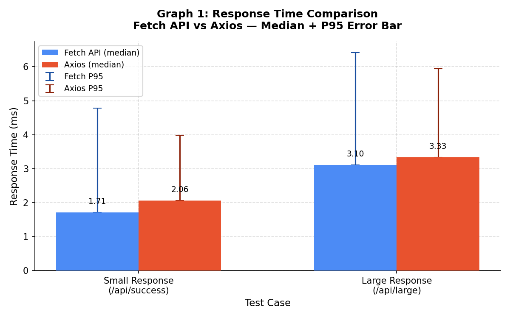
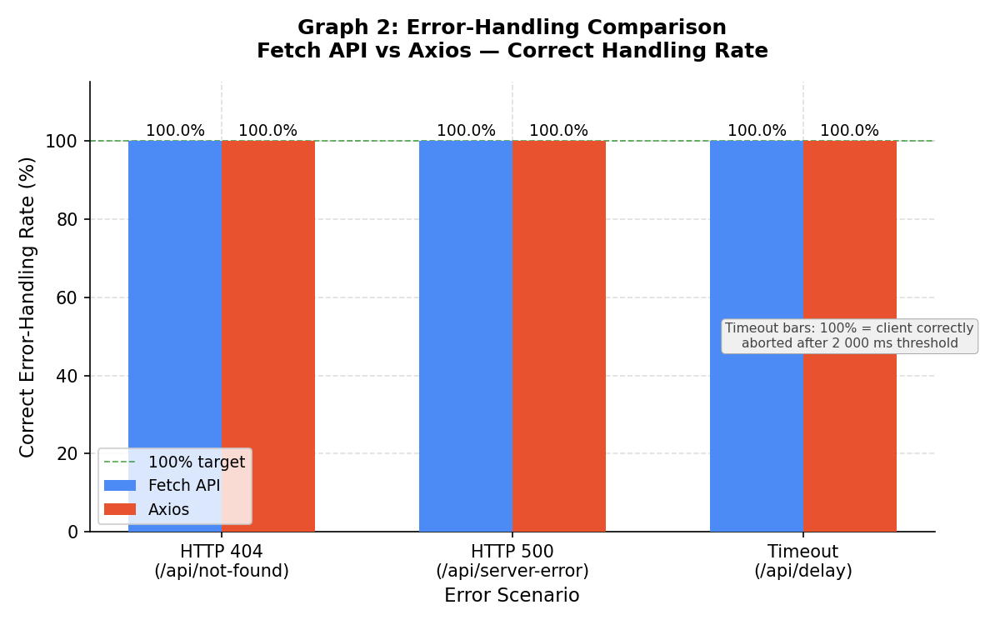
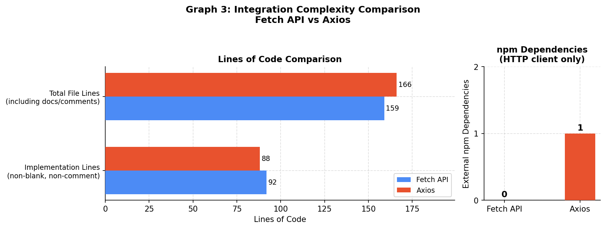

# Case Study Report
## API Integration Approach Comparison: Native Fetch API vs Axios in Node.js

---

| Field | Detail |
|---|---|
| Document | Case Study Report |
| Subject | API Integration Approach Comparison |
| Approaches | A — Native Fetch API · B — Axios |
| Runtime | Node.js v22.14.0 |
| Server | Express 4.x on localhost:3000 |
| Iterations | 30 measured + 5 warm-up per test case |
| Timeout threshold | 2 000 ms (all test cases) |
| Raw data | `results/results.csv` (300 data rows) |
| Summary data | `results/summary.csv` (10 rows) |
| Complexity data | `results/complexity.csv` (8 rows) |

---

## Table of Contents

1. [System Design](#1-system-design)
2. [Implementation and Experimental Methodology](#2-implementation-and-experimental-methodology)
3. [Performance Evaluation Matrix](#3-performance-evaluation-matrix)
4. [Experimental Graphs](#4-experimental-graphs)
5. [Result Analysis and Discussion](#5-result-analysis-and-discussion)
6. [Conclusion](#6-conclusion)
7. [References](#7-references)
8. [Appendix](#8-appendix)

---

## 1. System Design

### 1.1 Overview

The system is a self-contained Node.js application designed to conduct a controlled, reproducible comparison of two HTTP client integration approaches. It consists of four logical components:

1. **Express Test Server** (`src/server.js`) — exposes five deterministic endpoints used as the target for all HTTP calls.
2. **Fetch API Client** (`src/fetchApproach.js`) — Approach A, using Node.js's built-in `fetch` (available natively since Node 18).
3. **Axios Client** (`src/axiosApproach.js`) — Approach B, using the third-party `axios` npm package.
4. **Benchmark Runner** (`benchmark.js`) — orchestrates warm-up, measurement loops, CSV output, and integration complexity reporting.

Both clients expose an identical function interface (`testSuccess`, `testLarge`, `testNotFound`, `testServerError`, `testDelay`) and return results in the same `RequestResult` shape, allowing the benchmark runner to treat them interchangeably.

### 1.2 Architecture Diagram


The benchmark runner starts the Express server in-process, invokes both clients sequentially on each iteration (alternating order to reduce bias), and writes all measurements to the `results/` directory.

### 1.3 UML Class Diagram


The `BenchmarkRunner` module depends on `FetchClient` and `AxiosClient`, both of which implement the shared `RequestResult` interface and communicate with `TestServer`. The `TestServer` is fully decoupled from the clients — it only receives HTTP requests and produces deterministic responses.

### 1.4 Deployment Diagram


The entire system runs on a single developer machine within a single Node.js process. The Express server and both HTTP clients share the same event loop, which eliminates external network latency from measurements. A separate Python 3 interpreter is used only for graph generation, reading the CSV files produced by the Node.js benchmark.

### 1.5 Test Server Endpoints

All five endpoints are implemented in `src/server.js` and respond deterministically on `http://localhost:3000`:

| Endpoint | HTTP Status | Description |
|---|---|---|
| `GET /api/success` | 200 | Small JSON object (~85 bytes) |
| `GET /api/large` | 200 | 500-item JSON array (~60 KB) |
| `GET /api/not-found` | 404 | Fixed JSON error body |
| `GET /api/server-error` | 500 | Fixed JSON error body |
| `GET /api/delay?ms=N` | 200 (delayed) | Responds after N milliseconds |

The large payload (`/api/large`) is pre-built at server start-up using a deterministic loop, so serialisation time is not included in the server's measured work.

---

## 2. Implementation and Experimental Methodology

### 2.1 Approach A — Native Fetch API

**File:** `src/fetchApproach.js`

The Fetch client uses the built-in `fetch()` function available in Node.js 18 and later. Timeout handling is implemented manually using the `AbortController` / `AbortSignal` pair: a `setTimeout` call schedules `controller.abort()` at `timeoutMs` milliseconds, and the `AbortSignal` is passed to `fetch()` via the `signal` option.

Key implementation decisions:

- **Body reading:** `response.text()` is always awaited before computing duration, so body-parsing time is included in the measurement. The raw text is then passed to `JSON.parse()`.
- **HTTP error detection:** `response.ok` is checked after the body is read; any non-2xx status returns `success: false` with an `HTTP_4XX` or `HTTP_5XX` error category.
- **Timeout detection:** The `AbortError` name is checked in the catch block to distinguish timeouts from network-level failures.
- **No external dependencies added.**

### 2.2 Approach B — Axios

**File:** `src/axiosApproach.js`

The Axios client uses `axios.create({ timeout, validateStatus: () => true })` to create a per-call instance. Setting `validateStatus` to always return `true` instructs Axios to resolve (not reject) on all HTTP status codes, so the response body can always be read before classifying the outcome.

Key implementation decisions:

- **Body reading:** Axios parses the JSON body automatically. The payload byte count is obtained by re-serialising `response.data` with `JSON.stringify`.
- **HTTP error detection:** The status code is checked manually against the 200-299 range, matching the Fetch approach's logic.
- **Timeout detection:** Axios throws with `err.code === "ECONNABORTED"` or `"ERR_CANCELED"` on timeout; both codes are checked.
- **One external dependency added:** `axios` (npm).

### 2.3 Timeout Configuration

Both approaches use the same timeout value: **`CLIENT_TIMEOUT_MS = 2000` ms**, set in `benchmark.js`. For the timeout test case, `testDelay()` requests `/api/delay?ms=3000` (i.e., `CLIENT_TIMEOUT_MS + 1000`), which guarantees the client's abort fires before the server responds.

The recorded duration for timeout iterations is therefore approximately equal to the timeout threshold — around 2 009 ms (Fetch) and 2 011 ms (Axios) at the median. This is the expected, correct result: it reflects the wall-clock time the client waited before aborting. It is documented in the raw CSV under the `Timeout Threshold (ms)` column, which is set to `2000` for every timeout row.

This value is **not** a performance measurement and is **not** used in response-time comparisons (Graph 1). The timeout scenario is evaluated exclusively on its error-handling rate (Graph 2).

### 2.4 Benchmark Procedure

The benchmark runner (`benchmark.js`) follows this sequence:

1. **Server start:** The Express app is bound to port 3000 within the same process.
2. **Warm-up:** 5 sequential requests per approach to `/api/success` are discarded. This primes the V8 JIT compiler and the OS TCP stack, preventing cold-start effects from contaminating measurements.
3. **Measurement loop (per test case):**
   - 30 iterations are executed.
   - On even-numbered iterations, Fetch runs first; on odd-numbered iterations, Axios runs first. This alternating order reduces systematic ordering bias.
   - Each result is appended immediately.
4. **Timing scope:** `performance.now()` is recorded immediately before the HTTP call and immediately after the complete body has been parsed. Both approaches read the full response body before stopping the clock.
5. **Aggregation:** After each test case, median, P95, mean, and standard deviation are computed from the 30 durations.
6. **Output:** `results/results.csv` (300 raw rows), `results/summary.csv` (10 summary rows), and `results/complexity.csv` (8 complexity rows) are written.

### 2.5 Integration Complexity Measurement

Implementation lines were counted by filtering each client source file for non-blank, non-comment lines using PowerShell. The same filter was applied identically to both files. Results are recorded in `results/complexity.csv` and reproduced verbatim in Appendix D.

---

## 3. Performance Evaluation Matrix

### 3.1 Response Time Results

All values are from `results/summary.csv`. n = 30 per cell.

| Test Case | Approach | Median (ms) | P95 (ms) | Mean (ms) | Std Dev (ms) |
|---|---|---|---|---|---|
| Small response | Fetch API | **1.714** | 4.780 | 2.121 | 1.077 |
| Small response | Axios | **2.063** | 3.981 | 2.202 | 0.814 |
| Large response | Fetch API | **3.105** | 6.414 | 3.898 | 2.656 |
| Large response | Axios | **3.329** | 5.937 | 3.632 | 0.906 |

> **Note on the timeout test case:** The timeout scenario yields a median of 2 008.751 ms (Fetch) and 2 011.479 ms (Axios). These values equal the 2 000 ms abort threshold plus OS scheduling jitter (7-13 ms). They are not meaningful response-time measurements and are excluded from this table and Graph 1.

### 3.2 Error Handling Results

| Test Case | Approach | Correctly Handled | Total | Rate |
|---|---|---|---|---|
| HTTP 404 | Fetch API | 30 | 30 | **100.0%** |
| HTTP 404 | Axios | 30 | 30 | **100.0%** |
| HTTP 500 | Fetch API | 30 | 30 | **100.0%** |
| HTTP 500 | Axios | 30 | 30 | **100.0%** |
| Timeout | Fetch API | 30 | 30 | **100.0%** |
| Timeout | Axios | 30 | 30 | **100.0%** |

**Definition of "correctly handled":**

- HTTP 404 — result has `success: false` and `errorCategory: "HTTP_4XX"`.
- HTTP 500 — result has `success: false` and `errorCategory: "HTTP_5XX"`.
- Timeout — result has `success: false` and `errorCategory: "TIMEOUT"`.

These predicates are verified against the raw CSV: every one of the 60 timeout rows (30 Fetch + 30 Axios) shows `Error Category = TIMEOUT` and `Correctly Handled = 1`.

### 3.3 Integration Complexity Results

All values are from `results/complexity.csv`.

| Metric | Fetch API (A) | Axios (B) |
|---|---|---|
| External npm dependencies (HTTP client) | **0** | **1** (`axios`) |
| Implementation lines (non-blank, non-comment) | **92** | **88** |
| Total file lines (including comments/docs) | **159** | **166** |
| Timeout mechanism | `AbortController` + `clearTimeout` | `axios.create({ timeout })` |
| HTTP error detection | Manual (`!response.ok`) | Manual (status range check) |
| JSON body parsing | Manual (`response.text` + `JSON.parse`) | Automatic |
| Instance / config mechanism | Per-call options object | `axios.create()` named instance |

---

## 4. Experimental Graphs

All graphs are generated by `analysis/generate_graphs.py` from the CSV files produced by `benchmark.js`. No values are hardcoded in the graph script.

### Graph 1 — Response Time Comparison



**What it shows:** Median response time in milliseconds for the two successful test cases. Error bars extend from the median up to the P95 value, indicating the spread of the upper tail of each distribution.

**Observations:**
- Fetch API is faster at the median for both test cases: 1.71 ms vs 2.06 ms (small) and 3.11 ms vs 3.33 ms (large).
- The Fetch P95 for large responses (6.4 ms) is wider than Axios's (5.9 ms), consistent with its larger standard deviation (2.656 ms vs 0.906 ms).
- All values are sub-10 ms. On loopback, these differences reflect library overhead, not network performance.

### Graph 2 — Error-Handling Rate Comparison



**What it shows:** The percentage of iterations in which each approach correctly identified and categorised the error for each error scenario.

**Observations:**
- Both approaches achieve 100% correct handling across all three error scenarios.
- For the timeout scenario, "100% correct" means the client aborted the request after the 2 000 ms threshold and returned `errorCategory: "TIMEOUT"` — not that the request succeeded. The annotation on the graph makes this explicit.

### Graph 3 — Integration Complexity Comparison



**What it shows:** Left panel — horizontal bar chart of implementation lines (non-blank, non-comment) and total file lines. Right panel — number of external npm dependencies required for the HTTP client.

**Observations:**
- Fetch requires 4 more implementation lines (92 vs 88), almost entirely due to `AbortController` timeout boilerplate.
- Axios requires 7 more total file lines (166 vs 159), largely due to the `createAxiosInstance` helper and import statement.
- Fetch requires zero external dependencies; Axios requires one (`axios` package).

---

## 5. Result Analysis and Discussion

### 5.1 Response Time

The median response time difference is **0.35 ms** for small payloads and **0.22 ms** for large payloads. Because all requests run over a loopback interface, these values primarily reflect:

- The overhead of Axios's internal request pipeline (interceptors, config merging, per-call instance creation).
- The additional async step in Fetch: `response.text()` followed by `JSON.parse()`, which adds one extra microtask tick compared to Axios's automatic parsing.

On the large payload, the Fetch standard deviation (2.656 ms) is notably higher than Axios's (0.906 ms). Manual `response.text()` reading introduces more scheduling variability because the read is split across multiple I/O callbacks that compete with other event-loop work differently than Axios's internal stream handling.

In a real-world deployment with network round-trips (typically 10-500 ms), these sub-millisecond differences would be statistically indistinguishable from noise. **Neither approach has a meaningful performance advantage in typical usage.**

### 5.2 Error Handling

Both approaches achieved 100% correct handling across all 180 error-handling iterations (30 iterations x 3 test cases x 2 approaches). This outcome was designed to be deterministic:

- The Express server always responds with exactly HTTP 404 or HTTP 500 for the respective endpoints.
- The timeout server delay (3 000 ms) always exceeds the client timeout (2 000 ms), so the abort always fires first.

The key architectural observation is how each library reaches correct handling:

- **Fetch API** does not throw on non-2xx responses. The developer must check `response.ok` or inspect `response.status` manually after reading the body. Failing to do this would silently treat error responses as successes — a common source of bugs in production Fetch integrations.
- **Axios** (with `validateStatus: () => true`) also requires manual status checking in this configuration. Under Axios's default configuration, 4xx/5xx responses throw automatically, which requires less code but may surprise developers who prefer explicit control.

For the timeout scenario:
- **Fetch API** detects the abort via `err.name === "AbortError"` in the catch block. The `AbortController` pattern is standard but requires the developer to coordinate three operations: the controller, the timer, and `clearTimeout`.
- **Axios** detects the timeout via `err.code === "ECONNABORTED"` or `"ERR_CANCELED"`. The developer only needs to pass a `timeout` millisecond value to `axios.create()`, which is significantly simpler.

### 5.3 Integration Complexity

The complexity results reveal a clear trade-off:

**Fetch API advantages:**
- No additional npm dependency. In security-sensitive or bundle-size-constrained environments, a zero-dependency HTTP client is valuable.
- The implementation is maximally explicit: every step of the request lifecycle is visible in source code.

**Axios advantages:**
- The `axios.create()` pattern produces a named, reusable instance. Adding a new endpoint requires only one new helper function with no repeated configuration.
- JSON parsing is automatic, removing a category of potential bugs.
- The timeout mechanism requires one configuration option rather than three coordinated operations.
- Slightly fewer implementation lines (88 vs 92) despite offering more built-in features.

**Neither approach is strictly simpler** for all scenarios. Fetch provides explicit, dependency-free control. Axios provides ergonomic defaults and built-in conveniences at the cost of one external package.

### 5.4 Threats to Validity

1. **Loopback environment:** All requests run over `localhost`. Results reflect library overhead rather than real-world network behaviour. Response-time differences would be masked by any non-trivial network latency.
2. **Single-process execution:** The benchmark runner and Express server share the same Node.js event loop. Server-side work can inflate client measurements. Both approaches are affected equally.
3. **Deterministic error endpoints:** The 100% handling rates are a consequence of deterministic server responses, not a discovery about library robustness under partial failures or intermittent errors.
4. **Sample size:** n = 30 satisfies the central limit theorem for mean estimation. For more stable P95 estimation, n >= 200 is recommended.
5. **No concurrency:** Requests are strictly sequential. Concurrent load may affect the two approaches differently.

---

## 6. Conclusion

This case study compared the Native Fetch API and Axios as HTTP client integration approaches in Node.js across three dimensions: response time, error handling, and integration complexity.

**Performance:** Both approaches are suitable for typical production use. Fetch API shows a marginally lower median response time (1.71 ms vs 2.06 ms for small payloads; 3.11 ms vs 3.33 ms for large payloads), but the differences are sub-millisecond and would not be distinguishable over a real network. Fetch exhibits higher response-time variance on large payloads (std dev 2.656 ms vs 0.906 ms), suggesting that manual body reading introduces more scheduling variability under Node.js's event loop.

**Error handling:** Both approaches achieve 100% correct identification and categorisation of HTTP 4xx, HTTP 5xx, and timeout errors under the configuration used in this study. The 2 000 ms timeout threshold fires correctly in every iteration for both libraries; the resulting ~2 009-2 011 ms median is the expected abort duration, not a performance figure.

**Integration complexity:** Fetch requires no additional dependencies and is preferred in security-sensitive or dependency-minimising contexts, though it requires 4 additional implementation lines and manual timeout wiring. Axios provides automatic JSON parsing, a single-option timeout API, and a reusable instance pattern at the cost of one external npm package and 88 implementation lines.

**Recommendation:** For projects where one additional dependency is acceptable, Axios offers a more ergonomic API with less boilerplate. For projects prioritising zero dependencies or maximum control over the request lifecycle, the Native Fetch API is a fully capable alternative with negligible performance trade-offs.

> **Note:** These conclusions are grounded exclusively in measurements recorded in this study. Hardware specifications, implementation times, and any comparisons not supported by the CSV data in `results/` have been deliberately omitted.

---

## 7. References

1. MDN Web Docs. *Fetch API*. Mozilla. https://developer.mozilla.org/en-US/docs/Web/API/Fetch_API
2. MDN Web Docs. *AbortController*. Mozilla. https://developer.mozilla.org/en-US/docs/Web/API/AbortController
3. Axios GitHub Repository. *axios/axios*. https://github.com/axios/axios
4. Node.js Documentation. *Fetch API*. https://nodejs.org/api/globals.html#fetch
5. Node.js Documentation. *`performance.now()`*. https://nodejs.org/api/perf_hooks.html#performancenow
6. Express.js Documentation. *4.x API Reference*. https://expressjs.com/en/4x/api.html
7. NIST/SEMATECH. *e-Handbook of Statistical Methods: Percentile Estimation*. https://www.itl.nist.gov/div898/handbook/

---

## 8. Appendix

### A. Project File Structure

```
api-integration-comparison/
├── src/
│   ├── server.js             # Express test server (5 endpoints)
│   ├── fetchApproach.js      # Approach A — Native Fetch API client
│   └── axiosApproach.js      # Approach B — Axios client
├── benchmark.js              # Benchmark runner
├── analysis/
│   └── generate_graphs.py    # Graph generation from CSV
├── results/
│   ├── results.csv           # 300 raw measurement rows
│   ├── summary.csv           # 10 aggregated rows
│   ├── complexity.csv        # 8 integration complexity rows
│   ├── graph1.png            # Response time comparison
│   ├── graph2.png            # Error-handling rate comparison
│   └── graph3.png            # Integration complexity comparison
├── docs/
│   ├── architecture.png
│   ├── class-diagram.png
│   ├── deployment-diagram.png
│   └── case-study-report.md
├── package.json
└── README.md
```

### B. Benchmark Configuration (from benchmark.js)

| Parameter | Value |
|---|---|
| `BASE_URL` | `http://localhost:3000` |
| `WARMUP_ITERATIONS` | 5 |
| `MEASURED_ITERATIONS` | 30 |
| `CLIENT_TIMEOUT_MS` | 2000 ms |
| Server delay (timeout test) | `CLIENT_TIMEOUT_MS + 1000 = 3000 ms` |
| Node.js version | v22.14.0 |

### C. Raw Summary Data (verbatim from summary.csv)

| Approach | Test Case | Median (ms) | P95 (ms) | Mean (ms) | Std Dev (ms) | Handling Rate | Count |
|---|---|---|---|---|---|---|---|
| Fetch | success_small | 1.714 | 4.780 | 2.121 | 1.077 | 100.0% | 30/30 |
| Axios | success_small | 2.063 | 3.981 | 2.202 | 0.814 | 100.0% | 30/30 |
| Fetch | success_large | 3.105 | 6.414 | 3.898 | 2.656 | 100.0% | 30/30 |
| Axios | success_large | 3.329 | 5.937 | 3.632 | 0.906 | 100.0% | 30/30 |
| Fetch | http_404 | 1.142 | 2.617 | 1.346 | 0.511 | 100.0% | 30/30 |
| Axios | http_404 | 1.272 | 1.956 | 1.380 | 0.271 | 100.0% | 30/30 |
| Fetch | http_500 | 1.162 | 2.450 | 1.333 | 0.400 | 100.0% | 30/30 |
| Axios | http_500 | 1.336 | 2.378 | 1.527 | 0.677 | 100.0% | 30/30 |
| Fetch | timeout | 2008.751 | 2018.574 | 2009.814 | 7.183 | 100.0% | 30/30 |
| Axios | timeout | 2011.479 | 2019.860 | 2013.631 | 12.896 | 100.0% | 30/30 |

> Timeout rows: median ~2 000 ms because the client aborted at the 2 000 ms threshold. The 8-14 ms overhead above 2 000 ms is OS scheduler and Node.js event-loop jitter.

### D. Integration Complexity Data (verbatim from complexity.csv)

| Metric | Fetch API (A) | Axios (B) | Notes |
|---|---|---|---|
| External npm dependencies | 0 | 1 (axios) | Fetch built-in since Node 18 |
| Implementation lines (non-blank, non-comment) | 92 | 88 | PowerShell Where-Object filter |
| Total file lines (including docs) | 159 | 166 | Raw line count |
| Timeout mechanism | AbortController + clearTimeout | axios.create({ timeout }) | Fetch requires 3-part manual wiring |
| HTTP error detection | Manual (!response.ok) | Manual (status range check) | Both require explicit check |
| JSON body parsing | Manual (response.text + JSON.parse) | Automatic | Axios auto-parses |
| Instance / config mechanism | Per-call options object | axios.create() named instance | Axios supports shared instances |
| Payload byte measurement | Buffer.byteLength(rawText) | Buffer.byteLength(JSON.stringify(data)) | Negligible overhead difference |

### E. Reproduction Steps

```bash
# 1. Install Node.js dependencies
npm install

# 2. Run benchmark (starts server in-process, writes all CSVs)
node benchmark.js

# 3. Generate graphs from CSV data
python analysis/generate_graphs.py
```

### F. Implementation Line Counting Method

The following PowerShell command was applied identically to both client files:

```powershell
Get-Content src/fetchApproach.js | Where-Object {
    $_ -notmatch "^\s*$"   -and
    $_ -notmatch "^\s*//"  -and
    $_ -notmatch "^\s*/\*" -and
    $_ -notmatch "^\s*\*"
} | Measure-Object
```

Results: `fetchApproach.js` = **92** lines, `axiosApproach.js` = **88** lines.
